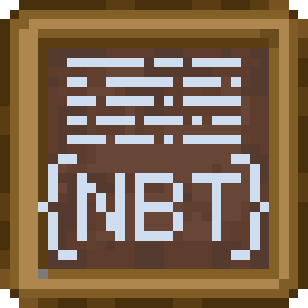

<!-- PROJECT BADGES -->
<div align="center">

[![Packagist][packagist-badge]][packagist-url]
[![Downloads][downloads-badge]][packagist-url]
[![CI][ci-badge]][ci-url]
[![PHP][php-badge]][php-url]
[![License][license-badge]][license-url]

</div>

<!-- PROJECT LOGO -->
<br />
<div align="center">
  
  <h3>nbt-serializer</h3>
  <p align="center">
    Turn any NBT tag into a string and back, in one line.<br/>
    Fast, safe and well tested, for <a href="https://github.com/axolotl-pm/PocketMine-MP">axolotl-pm/PocketMine-MP</a>.

[View on Packagist][packagist-url] · [Changelog][changelog-url] · [Report a bug][issues-url] · [Request a feature][issues-url]

  </p>
</div>

```php
$snbt = NbtSerializer::toSnbt($item->nbtSerialize());   // {Count:1b,Name:"minecraft:diamond_sword",...}
$tag  = NbtSerializer::fromSnbt($snbt);                 // back to the CompoundTag
```

## ✨ Highlights

- **One-liners** for SNBT, binary (big / little endian), Base64, hex and compressed formats.
- **Fast** : up to 71% faster than the previous version and byte-for-byte compatible with `pocketmine/nbt`. [Benchmarks][performance-url]
- **Safe for untrusted input** : every invalid input throws `NbtDataException` (or returns `null` with `tryFrom*()`),
  with nesting depth, length and decompression size limits.
- **Deterministic** : sorted SNBT keys and `hash()`, so equal tags always give the same string.
- **Toolbox** : NBT paths (`tag.display.Lore[0]`), deep merge and diff.
- **Reliable** : 129 tests, including randomized comparisons with `pocketmine/nbt`, on PHP 8.4 and 8.5.

---

## 📦 Installation

| Requirement               | Version                                                   |
|---------------------------|-----------------------------------------------------------|
| Server                    | [axolotl-pm/PocketMine-MP][axolotl-url]                   |
| PHP                       | **8.4** or newer                                          |
| [pocketmine/nbt][nbt-url] | `^1.2` (bundled with the server)                          |

```bash
composer require presentkim/nbt-serializer
```

> **For plugins** : bundle the `vendor` directory into the plugin and load `vendor/autoload.php` (e.g. in `onLoad()`).
> Since it is not shaded like a virion, keep a single copy per server, or prefix the namespace with
> [PHP-Scoper](https://github.com/humbug/php-scoper) to avoid class conflicts between plugins.

> **Using the original [pmmp/PocketMine-MP](https://github.com/pmmp/PocketMine-MP) 5.x?**
> Install `presentkim/nbt-serializer:^2.1`, or see the [`legacy/pmmp-5.44`][legacy-url] branch (Poggit virion).

---

## 🎯 Use cases

| You want to...                                         | Use                                                    |
|--------------------------------------------------------|--------------------------------------------------------|
| Save items, inventories or entity data in a database   | `toCompressed()` + `base64_encode()`, or `toBase64()`  |
| Store data humans can read and edit (configs, logs)    | `toSnbt()` / `toSnbtPretty()`                          |
| Accept NBT from commands, forms or other players       | `tryFromSnbt($input, maxDepth: 32, maxLength: 4096)`   |
| Read / write Bedrock files (worlds, `.mcstructure`)    | `fromBinary($data, Endian::LITTLE)`                    |
| Read / write Java Edition `.nbt` / `.dat` files        | `fromCompressed($data)` (gzip, big endian)             |
| Find duplicated items, cache by content                | `hash($tag)`                                           |
| Edit a value deep in a tree                            | `NbtPath::parse("tag.display.Name")->set(...)`         |
| Apply item templates, track changes                    | `NbtTree::merge()` / `NbtTree::diff()`                 |

---

## 🤔 Why use it

**Shorter.** pocketmine/nbt has no SNBT writer, and its binary API needs a serializer, a `TreeRoot` and the root name every time.
Here every format is one static call, and the decoded tag is returned directly.

```php
// pocketmine/nbt
$data = (new BigEndianNbtSerializer())->write(new TreeRoot($tag));
$tag = (new BigEndianNbtSerializer())->read($data)->getTag();

// nbt-serializer
$data = NbtSerializer::toBinary($tag);
$tag = NbtSerializer::fromBinary($data);
```

**Faster.** The binary codec writes the same bytes as pocketmine/nbt, while packing numeric lists at once
and building the decoded tags without per-entry checks. See [PERFORMANCE.md][performance-url].

**Safer.** Data from players, files or the network can be malformed or malicious.
Every `from*()` method validates the input, limits the nesting depth (512 by default) and the decompressed size (64 MiB by default),
and throws a single exception type, so a bad input never crashes the server with a `TypeError` or a PHP warning.

**Correct.** Floats are written without precision loss, any byte string survives SNBT, and the output is tested against
pocketmine/nbt with thousands of random trees on every commit.

---

## 🗂️ Choosing a format

Sizes of an inventory of 36 different items :

| Format                     | Methods                              | Size     | Human readable | Text safe | Notes                                          |
|----------------------------|--------------------------------------|----------|:--------------:|:---------:|------------------------------------------------|
| SNBT                       | `toSnbt()` / `fromSnbt()`            | 5.9 KB   | ✅              | ✅         | The format of Minecraft commands               |
| Binary                     | `toBinary()` / `fromBinary()`        | 6.4 KB   | ❌              | ❌         | Fastest, use a `BLOB` column                   |
| Base64                     | `toBase64()` / `fromBase64()`        | 8.5 KB   | ❌              | ✅         | Binary for text storage                        |
| Hex                        | `toHex()` / `fromHex()`              | 12.8 KB  | ❌              | ✅         | Binary for alphanumeric only channels          |
| Compressed                 | `toCompressed()` / `fromCompressed()`| 1.3 KB   | ❌              | ❌         | Smallest, `base64_encode()` it for text (1.8 KB) |

Every binary based method takes an `Endian` (`Endian::BIG` by default, `Endian::LITTLE` for Bedrock Edition files).

---

## 🚀 Usage

Every class is in the `kim\present\serializer\nbt` namespace.

### SNBT

```php
NbtSerializer::toSnbt(Tag $tag, bool $sortKeys = true) : string
NbtSerializer::toSnbtPretty(Tag $tag, int $indentLevel = 0, string $indentChar = "    ", string $lineBreak = "\n", bool $sortKeys = true) : string
NbtSerializer::fromSnbt(string $contents, int $maxDepth = 512, ?int $maxLength = null) : Tag
NbtSerializer::tryFromSnbt(string $contents, int $maxDepth = 512, ?int $maxLength = null) : ?Tag
```

```js
{
    Count: 1b,
    Damage: 0s,
    Name: "minecraft:diamond_sword",
    Slot: 12b,
    tag: {
        RepairCost: 3,
        display: {
            Lore: ["Forged in dragon’s fire", "Damage +20"],
            Name: "Dragon Slayer"
        },
        ench: [{id: 9s, lvl: 5s}, {id: 12s, lvl: 2s}]
    }
}
```

- Compound entries are **sorted by key** by default, so equal tags always produce the same string.
  Pass `sortKeys: false` to keep the insertion order.
- Floats are written without precision loss (`0.30000000000000004d`), non-finite values as `NaN`, `Infinity`, `-Infinity` with the `f` / `d` suffix.
- Strings are quoted with `"` and only quotes, backslashes and control characters are escaped, so unicode stays readable and every byte is preserved.
- Both `"` and `'` quoted strings are accepted, with the `\\`, `\"`, `\'`, `\n`, `\t`, `\uXXXX`, ... escapes.
- See the [Minecraft wiki](https://minecraft.wiki/w/NBT_format#SNBT_format) for the SNBT syntax.

### Binary, Base64 and Hex

```php
NbtSerializer::toBinary(Tag $tag, Endian $endian = Endian::BIG) : string
NbtSerializer::fromBinary(string $contents, Endian $endian = Endian::BIG, int $maxDepth = 512) : Tag

NbtSerializer::toBase64(Tag $tag, Endian $endian = Endian::BIG) : string
NbtSerializer::fromBase64(string $contents, Endian $endian = Endian::BIG, int $maxDepth = 512) : Tag

NbtSerializer::toHex(Tag $tag, Endian $endian = Endian::BIG) : string
NbtSerializer::fromHex(string $contents, Endian $endian = Endian::BIG, int $maxDepth = 512) : Tag
```

The binary output is byte-for-byte identical to `pocketmine\nbt\BigEndianNbtSerializer` / `LittleEndianNbtSerializer`
(the root tag is written with an empty name). Unlike pocketmine/nbt, negative `TAG_Int_Array` values are decoded with their sign.

### Compressed binary

```php
NbtSerializer::toCompressed(Tag $tag, Compression $compression = Compression::GZIP, Endian $endian = Endian::BIG, int $level = -1) : string
NbtSerializer::fromCompressed(string $contents, Compression $compression = Compression::GZIP, Endian $endian = Endian::BIG, int $maxDepth = 512, int $maxLength = 64 MiB) : Tag
```

- `Compression::GZIP` : the format of Java Edition `.nbt` / `.dat` files
- `Compression::ZLIB` : zlib (`gzcompress()`)
- `Compression::DEFLATE` : raw deflate, the smallest output

`$maxLength` limits the size of the decompressed data, to protect against decompression bombs.

```php
// store an inventory in a text column
$contents = base64_encode(NbtSerializer::toCompressed($inventoryTag, Compression::DEFLATE));
$inventoryTag = NbtSerializer::fromCompressed(base64_decode($contents), Compression::DEFLATE);
```

### Untrusted input

Every `from*()` method has a `tryFrom*()` variant returning `null` instead of throwing :
`tryFromSnbt()`, `tryFromBinary()`, `tryFromBase64()`, `tryFromHex()`, `tryFromCompressed()`.

```php
$tag = NbtSerializer::tryFromSnbt($args[0], maxDepth: 32, maxLength: 4096);
if($tag === null){
    $sender->sendMessage("Invalid NBT");
    return;
}
```

### Hashing

```php
NbtSerializer::hash(Tag $tag, string $algo = "xxh128") : string
```

Equal tags (by `Tag::equals()`) always have the same hash, regardless of the order of the compound entries.
Any algorithm supported by `hash()` can be used.

### NBT path

Read and modify a tag deep in the tree, with a path like the Minecraft NBT path.

```php
$path = NbtPath::parse('tag.display.Lore[0]');   // parsed paths are cached

$path->get($tag);                                 // ?Tag
$path->has($tag);                                 // bool
$path->set($tag, new StringTag("First line"));    // missing compounds are created
$path->remove($tag);                              // bool, whether it existed

NbtPath::parse('tag."key with.dot"[-1]');         // quoted keys, negative index from the end
(string) NbtPath::of("tag", "a.b", 0);            // 'tag."a.b"[0]'
```

| Syntax                     | Meaning                                                                 |
|----------------------------|-------------------------------------------------------------------------|
| `key`, `"key"`, `'key'`    | Entry of a compound tag, joined with `.`                                |
| `[index]`                  | Entry of a list tag (byte / int arrays can be read too), `[-1]` is the last |
| (empty string)             | The root tag itself                                                     |

`set()` either fully succeeds or leaves the tree unchanged.

### Merge and diff

```php
// deep merge like the `/data merge` command, neither argument is modified
$merged = NbtTree::merge($template, $patch);

// differences between two trees
foreach(NbtTree::diff($old, $new) as $change){
    // $change->path (NbtPath), $change->old (?Tag), $change->new (?Tag)
    echo $change->path, " : ", $change->isAdded() ? "added" : ($change->isRemoved() ? "removed" : "modified"), "\n";
}

// apply the differences to another tree
NbtTree::apply($target, NbtTree::diff($old, $new));
```

---

## ⚠️ Exceptions

| Exception                                               | Thrown when                                                                  |
|---------------------------------------------------------|------------------------------------------------------------------------------|
| `pocketmine\nbt\NbtDataException`                       | Invalid NBT data in any format (SNBT errors are `SnbtSyntaxException` / `SnbtDataException`) |
| `InvalidArgumentException`                              | Invalid Base64 / hex encoding, invalid arguments (e.g. `maxLength < 1`), strings too long for NBT |
| `kim\present\serializer\nbt\exception\NbtPathException` | Invalid path syntax, or a `set()` that can not be applied                    |

The `tryFrom*()` methods return `null` for invalid input instead.

---

## 📊 Performance

| Operation (µs, PHP 8.3 + OPcache) | Item    | Inventory (36 items) | Numeric lists |
|-----------------------------------|---------|----------------------|---------------|
| `toBinary`                        | 4.6     | 161                  | 92            |
| `fromBinary`                      | 10.1    | 353                  | 305           |
| `toSnbt`                          | 5.9     | 216                  | 835           |
| `fromSnbt`                        | 15.5    | 549                  | 1887          |

The binary formats are 1.3~1.5 times faster than SNBT for items, and 6~9 times faster for numeric data.
See [PERFORMANCE.md][performance-url] for the details.

---

## 🛠️ Development

```bash
composer install
composer test
```

Contributions are welcome. Please open an [issue][issues-url] for bugs and feature requests.

## 📝 License

Distributed under the **MIT** License. See [LICENSE][license-url] for more information.


[packagist-badge]: https://img.shields.io/packagist/v/presentkim/nbt-serializer.svg?style=for-the-badge

[downloads-badge]: https://img.shields.io/packagist/dt/presentkim/nbt-serializer.svg?style=for-the-badge

[ci-badge]: https://img.shields.io/github/actions/workflow/status/presentkim-pm/nbt-serializer/ci.yml?branch=main&style=for-the-badge

[php-badge]: https://img.shields.io/badge/php-%3E%3D8.4-777BB4.svg?style=for-the-badge

[license-badge]: https://img.shields.io/github/license/presentkim-pm/nbt-serializer.svg?style=for-the-badge

[packagist-url]: https://packagist.org/packages/presentkim/nbt-serializer

[changelog-url]: https://github.com/presentkim-pm/nbt-serializer/blob/main/CHANGELOG.md

[ci-url]: https://github.com/presentkim-pm/nbt-serializer/actions/workflows/ci.yml

[php-url]: https://www.php.net/releases/8.4/

[axolotl-url]: https://github.com/axolotl-pm/PocketMine-MP

[nbt-url]: https://github.com/pmmp/NBT

[legacy-url]: https://github.com/presentkim-pm/nbt-serializer/tree/legacy/pmmp-5.44

[issues-url]: https://github.com/presentkim-pm/nbt-serializer/issues

[license-url]: https://github.com/presentkim-pm/nbt-serializer/blob/main/LICENSE

[performance-url]: https://github.com/presentkim-pm/nbt-serializer/blob/main/PERFORMANCE.md
